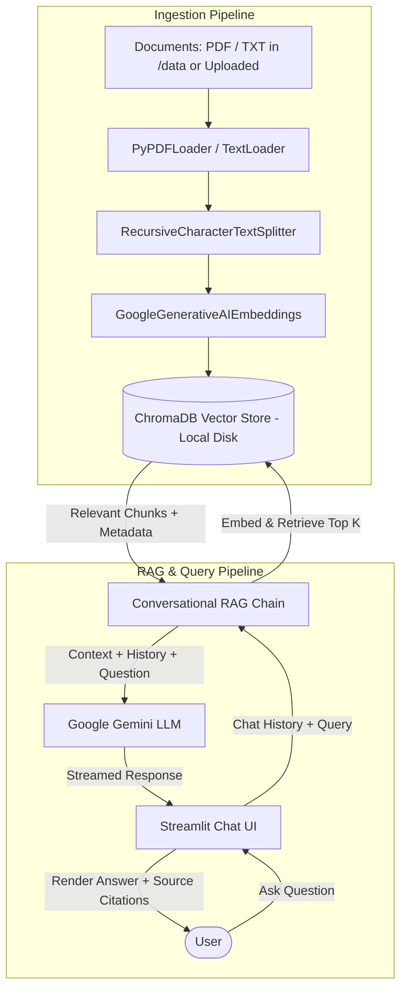

# Production-Ready RAG Chatbot Implementation Plan

## 1. Project Overview & Architecture

This project is an enterprise-grade Retrieval-Augmented Generation (RAG) conversational assistant powered by:
- **LLM**: Google Gemini (`gemini-1.5-flash` / `gemini-1.5-pro` or `gemini-2.5-flash`) via `langchain-google-genai`
- **Embeddings**: Google AI Embeddings (`models/text-embedding-004`)
- **Vector Database**: ChromaDB with disk persistence
- **Framework**: LangChain v0.2+ / v0.3 LCEL (LangChain Expression Language) architecture
- **Frontend / UI**: Modern Streamlit interface with chat history, document upload, and citation cards
- **Deployment**: Dockerized with multi-platform compatibility (Cloud Run / Render ready)

### Architectural Flow



---

## 2. Directory Structure

```text
ai chatbot/
├── .env.example              # Environment variables template
├── .env                      # Local environment file (ignored by git)
├── .gitignore                # Git ignore rules for venv, chromadb, keys
├── Dockerfile                # Production Docker container definition
├── .dockerignore             # Excludes for Docker build
├── README.md                 # Setup, configuration, and user documentation
├── requirements.txt          # Pinned production Python dependencies
├── tasks.md                  # Project tracking & roadmap checklist
├── config.py                 # Centralized configuration, validation & environment loading
├── ingest.py                 # Document processing, chunking, embedding & vector store persistence
├── rag_chain.py              # Conversational retrieval chain with memory & citation handling
├── app.py                    # Streamlit web application with modern UI & upload workflow
├── data/                     # Local storage for source documents (PDF, TXT)
└── chroma_db/                # Local persistent Chroma vector store directory
```

---

## 3. Implementation Checklist & Status

### Phase 1: Environment & Dependencies
- [x] Create `tasks.md` with architectural design and detailed roadmap
- [x] Create `.env.example` defining `GEMINI_API_KEY`, model names, chunk size/overlap, and directory paths
- [x] Create `requirements.txt` with locked, compatible versions of LangChain, ChromaDB, Google GenAI, Streamlit, and PyPDF
- [x] Create `.gitignore` to prevent sensitive credentials and vector databases from leaking

### Phase 2: Configuration Management (`config.py`)
- [x] Implement `Settings` class / config module with `python-dotenv`
- [x] Securely read and validate `GEMINI_API_KEY` (and `GOOGLE_API_KEY` fallback)
- [x] Define customizable parameters:
  - Model names (`gemini-1.5-flash` or `gemini-2.5-flash`, `models/text-embedding-004`)
  - Chunk size (e.g. 1000) and chunk overlap (e.g. 200)
  - Chroma storage path (`./chroma_db`) and data directory (`./data`)
  - Retrieval parameters (`k=4`, search type)
- [x] Add diagnostic and validation functions to verify API key presence

### Phase 3: Ingestion Pipeline & Vector Persistence (`ingest.py`)
- [x] Support loading both PDF (`PyPDFLoader`) and TXT (`TextLoader`) files
- [x] Implement `RecursiveCharacterTextSplitter` with intelligent chunk overlap and separator hierarchy
- [x] Configure `GoogleGenerativeAIEmbeddings` using `models/text-embedding-004`
- [x] Initialize persistent `Chroma` client pointing to local directory
- [x] Support incremental / idempotent ingestion (preventing redundant document indexing)
- [x] Implement batch ingestion from `/data` and individual uploaded file ingestion for runtime use
- [x] CLI execution support (`python ingest.py`) with rich progress logging

### Phase 4: Conversational RAG Pipeline (`rag_chain.py`)
- [x] Configure `ChatGoogleGenerativeAI` with appropriate temperature, top_p, and safety settings
- [x] Construct standalone question rephrasing prompt (contextualize question chain with chat history)
- [x] Design robust RAG prompt template instructing Gemini:
  - Ground responses in provided context
  - Provide accurate and faithful answers
  - Explicitly acknowledge when information is missing from documents
  - Include file source names and page references
- [x] Assemble LCEL pipeline returning both generated answer and retrieved source documents
- [x] Format source metadata (filename, page number, preview snippet) for UI citations

### Phase 5: Modern Streamlit Chat Interface (`app.py`)
- [x] Set page configuration (modern theme, favicon, title, wide layout)
- [x] Build responsive Sidebar:
  - API key status check & manual override option
  - Document uploader (PDF & TXT) with automatic ingestion into ChromaDB
  - Vector database statistics (total indexed documents / chunks)
  - "Clear Chat History" & "Rebuild Index" actions
  - Model and retrieval hyperparameter controls (temperature, top-k chunks)
- [x] Build Chat Window:
  - Welcome greeting and sample prompt pills
  - Persistent session state for `messages` and conversation memory
  - Message rendering with `st.chat_message` (User and Assistant avatars)
  - Collapsible citation expanders showcasing source document, page, and chunk excerpt
  - Graceful error boundaries (API key errors, empty queries, empty index alerts)

### Phase 6: Containerization & Cloud Deployment
- [x] Write optimized `Dockerfile` (Python 3.11-slim, non-root user, proper caching)
- [x] Configure Streamlit headless port binding (`PORT=8501`, `0.0.0.0`)
- [x] Create `.dockerignore` for minimal image size
- [x] Document deployment instructions for Google Cloud Run, Render, and local Docker

### Phase 7: Verification & Testing
- [x] Test end-to-end Python syntax and import compilation
- [x] Verify ChromaDB vector store initialization logic
- [x] Validate retrieval accuracy, chat memory, and citation output formatting

### Phase 8: Document Management & Cross-Encoder Re-Ranking Upgrades
- [x] Add selective document management to `ingest.py` (`get_all_indexed_documents`, `delete_documents_by_source`)
- [x] Add interactive Document Management Dashboard in `app.py` sidebar (file listing, chunk counts, individual delete buttons)
- [x] Install `sentence-transformers>=2.2.2` and update `requirements.txt`
- [x] Implement Cross-Encoder re-ranker in `rag_chain.py` (`cross-encoder/ms-marco-MiniLM-L-6-v2`)
- [x] Integrate re-ranker into retrieval chain (retrieving candidate pool k=20, re-ranking to top-k chunks)

### Phase 9: Hybrid Local RAG & Live Web-Surfing AI Agent Mode
- [x] Create `web_search_agent.py` with `search_web_and_scrape(query, max_results)` using `duckduckgo-search` and `beautifulsoup4`
- [x] Strip non-content HTML tags (`<script>`, `<style>`, `<nav>`, `<footer>`, `<header>`, etc.) and package into LangChain `Document`s
- [x] Update `rag_chain.py` to retrieve both persistent local ChromaDB documents and dynamic web scrapes
- [x] Unify candidates into a single pool and pass through Cross-Encoder re-ranker
- [x] Update Gemini prompt to synthesize answers across local documents and live web search results
- [x] Add `Enable Hybrid Web Search Agent` toggle in `app.py` sidebar
- [x] Upgrade UI citation cards with dual styling (local documents vs clickable live web URLs)
- [x] Update `requirements.txt` with `duckduckgo-search`, `beautifulsoup4`, and `requests`

